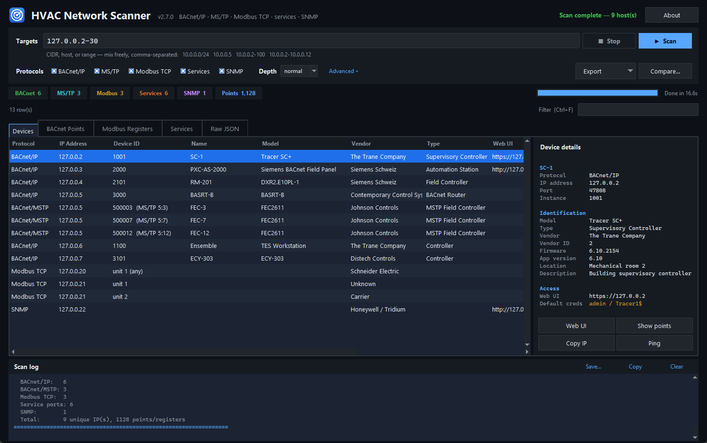

# HVAC Network Scanner

A multi-protocol discovery and audit tool for HVAC and building automation networks. Zero third-party dependencies — everything runs on the Python 3.10+ standard library.

Looking for a Siemens APOGEE P2 scanner or P2 Wireshark Decoder? See this project [P2Scanner](https://github.com/jamesccupps/P2_Wireshark_Dissector_And_P2_Scanner)

[](https://github.com/jamesccupps/HVAC-Network-Scanner/actions/workflows/ci.yml)
[](LICENSE)
[](https://www.python.org/downloads/)



## What it does

Scans a network and tells you what building-automation gear lives on it. For each device found it tries to identify the exact model, pull readable points or registers, and surface the factory-default credentials that ship with that product so you can confirm they've been changed.

Works against:

- **BACnet/IP** — raw UDP `Who-Is` / `I-Am`, `ReadProperty`, and `ReadPropertyMultiple`. No BAC0 dependency, works on newer python versions. Reaches other subnets and VLANs by unicast discovery or through a BBMD.
- **BACnet MSTP** — device enumeration behind BACnet routers via `Who-Is-Router-To-Network` and targeted `Who-Is` to remote DNETs.
- **Modbus TCP** — port sweep, device identification (FC 43 / MEI 14), holding/input register reads, and coil reads.
- **HVAC services** — Niagara Fox, OPC UA, Siemens S7, EtherNet/IP CIP, KNXnet/IP, LonWorks/IP, MQTT, WebCTRL, Metasys, plus HTTP/HTTPS banner grabs.
- **SNMP v1/v2c** — raw UDP `sysDescr` probe, no pysnmp dependency.

Model identification combines signals from multiple protocols:

- Trane Tracer SC / SC+ / UC600 / UC400
- Siemens Desigo PXC automation stations, Desigo CC, TX-I/O modules
- Johnson Controls FEC / Metasys NAE
- Honeywell / Tridium Niagara
- Schneider EcoStruxure / SmartX
- Contemporary Controls BASRT-B routers
- Carrier i-Vu, Automated Logic WebCTRL, Distech, Delta, KMC, Reliable, Carel, Belimo, Daikin, Mitsubishi, LG, and more

## Tested against (verified hardware)

The scanner has been verified against real hardware in live
installations. These devices have known-good classification profiles:

- **Trane Tracer SC+** — supervisory controller (5,000+ objects)
- **Trane Symbio 400-500** — field controller (MSTP)
- **Trane Tracer Ensemble (TES Workstation)** — supervisor
  (handles RPM rejection via fallback to single ReadProperty)
- **Siemens PXC Compact** (EPXC V3.5.x firmware) — field panel
- **Siemens PXC Modular** (PXME V3.5.x firmware) — field panel
  (verified with 1,960-object program)
- **Siemens DXR2.E10PL-1, .E12P-1, .E18-1** — room controllers
- **Siemens Desigo CC / Insight** — supervisors

Across these, the scanner has been tested with ~13,000 points read
and ~30,000 paired BACnet exchanges at zero wire-level errors.

**For hardware not on this list**, the scanner uses a size-based
heuristic that sets an appropriate object enumeration cap from the
device's own reported object count. This is expected to work
correctly for any BACnet-compliant device. If you scan a device that
isn't on this list, please consider [contributing a profile](CONTRIBUTING.md)
so future users can benefit from verified classification.

**Known out-of-scope:**

- Panels running proprietary firmware that doesn't include BACnet/IP.
  For example, Siemens APOGEE PXC panels running firmware revision 2.x
  speak Apogee P2 Ethernet rather than BACnet/IP. These panels may have
  IP addresses and be actively managed by Siemens Desigo CC, but they
  don't answer BACnet/IP. The same hardware upgraded to firmware
  revision 3.x or later would be scannable. If you're affected, check
  with your Siemens representative about a firmware upgrade path — or
  use commercial P2 gateways like PurpleSwift BACnetP2 for integration.
- Proprietary BMS protocols that are not BACnet or Modbus TCP
  (JCI N2, LonTalk, Honeywell C-Bus, various others).

## Install

```bash
git clone https://github.com/jamesccupps/HVAC-Network-Scanner.git
cd HVAC-Network-Scanner
pip install -e .
```

Or run straight from the source tree without installing:

```bash
python -m hvac_scanner           # launches the GUI
python -m hvac_scanner.cli --help
```

Requires Python 3.10 or newer. No extra packages.

### Try it without a building

`tools/sim_site.py` stands up a small simulated site on loopback addresses —
a Trane SC+, Siemens PXC and DXR2 controllers, an MS/TP router with three
JCI field controllers behind it, a workstation that rejects
ReadPropertyMultiple, Modbus meters and a gateway, a Niagara JACE with SNMP
and Fox, and web UIs. Real sockets on the real ports, so the whole scanner
runs against it:

```bash
python tools/sim_site.py            # leave running
python -m hvac_scanner              # scan 127.0.0.2-30 in the GUI
```

The screenshot above was taken against it. Windows and Linux only (macOS
needs loopback aliases); ports below 1024 need root on Linux.

### Standalone executable

For a Windows machine without Python — an engineering workstation you would
rather not install anything on — grab `HVACNetworkScanner.exe` from the
[latest release](https://github.com/jamesccupps/HVAC-Network-Scanner/releases).
One ~13 MB file, no installer, no runtime.

To build it yourself:

```bash
pip install -e ".[build]"
pyinstaller packaging/hvac_scanner.spec --noconfirm
# -> dist/HVACNetworkScanner.exe
```

PyInstaller is a build dependency only; the package itself stays
dependency-free at runtime. The executable ships the GUI — the CLI remains
available from a normal Python install.

**The executable is not code-signed.** On first run Windows SmartScreen will
show *"Windows protected your PC"* and you will need **More info → Run
anyway**. That warning means the binary has no purchased signing certificate,
not that anything is wrong with it — but a network scanner is exactly the sort
of program where you should not simply take that on trust.

Verify it before you run it. Each release publishes the SHA-256 of the
executable next to the download; compare it against the file you got:

```powershell
Get-FileHash .\HVACNetworkScanner.exe -Algorithm SHA256
```

The binary is built by GitHub Actions from the tagged commit, not on a
developer machine — the workflow is in
[.github/workflows/ci.yml](.github/workflows/ci.yml) and its build log is
public, so you can see exactly what went into it. If you would rather not
trust a binary at all, build it yourself with the two commands above; it is
the same spec file CI uses.

## Using the GUI

```bash
python -m hvac_scanner
```

Type the network(s) to scan, tick the protocols, press **Scan** (or
Ctrl+Enter). Results appear as each device finishes, not at the end:

- **Devices** — one row per device across protocols: address, the device's
  own name, model, vendor, type, web UI and the factory-default credentials
  for that product. Select a row for everything the scan learned about it in
  the details panel; double-click it (or **Show points**) to list its points.
  Right-click for web UI, copy, ping.
- **BACnet Points** — every object read, with present value, engineering
  units and status. Points in alarm or fault are red, overridden or out of
  service amber, and multi-state values read as their state text
  ("Occupied"). Double-click a point for its full name and description.
- **Modbus Registers**, **Services** (open ports, banners, page titles, TLS
  certificates) and **Raw JSON**.

The filter box (Ctrl+F) narrows every tab at once — type `vav` or a device
name or an IP. Column headers sort; IP addresses sort numerically. Ctrl+C
copies the selected rows as tab-separated text that pastes straight into a
spreadsheet.

**Export** writes a **survey report** (HTML — findings, inventory and open
services in one file you can hand to the building owner), the device list
(CSV), a **point list** (CSV, one row per point and register — the thing you
take away from a site survey), the full results (JSON, also Ctrl+S) or a
classification report. **Compare** diffs this
scan against an earlier JSON export.

**Advanced** holds the timeout, the per-device rate limit (use 20-50 ms on
sites with small field controllers), parallel deep scans, unicast discovery,
BBMD registration, broadcast override, Who-Is chunking, an object cap and
SNMP communities. Everything you set is remembered for next time.

### Target syntax

The target field and CLI accept any mix of:

```
10.0.0.0/24                       # CIDR
10.0.0.5                          # single host
10.0.0.2-100                      # last-octet range
10.0.0.2-10.0.0.12                # full-IP range
10.0.0.0/30, 10.0.1.5, 10.0.2.1-20  # mixed list
```

The broadcast address for BACnet Who-Is is computed automatically from
whatever you type — narrow CIDRs (e.g. `/26`), ranges, and single hosts
all auto-broadcast to the enclosing `/24`. The scan log shows the chosen
broadcast target so it's never magic. Power users can override via the
`--broadcast` CLI flag or `ScanOptions.bacnet_broadcast`.

## Using the CLI

New in v2. Runs headless — no display, no Tk. Intended for Task Scheduler, cron, and CI pipelines.

```bash
# Basic scan of a /24
python -m hvac_scanner.cli 192.168.1.0/24

# Multiple networks, export to JSON and CSV
python -m hvac_scanner.cli 10.0.0.0/24 10.0.1.0/24 \
    --json scan.json --csv scan.csv

# BACnet only, with conservative rate limiting for small JACEs / UC400s
python -m hvac_scanner.cli 192.168.5.0/24 --bacnet-only --rate-limit 50

# Large-campus friendly: chunk Who-Is by 1000-instance ranges instead of
# one global broadcast. Avoids I-Am storms on big sites.
python -m hvac_scanner.cli 10.0.0.0/24 --whois-chunk 1000 --rate-limit 50

# Scan a narrow range of hosts — broadcast is auto-computed:
python -m hvac_scanner.cli 10.0.0.2-100

# Target specific devices only (no scan sweep at all):
python -m hvac_scanner.cli 10.0.0.19,10.0.0.21,10.0.0.192

# The BAS is on its own VLAN and broadcasts do not reach it: ask each
# address directly (this happens automatically for non-local subnets)
python -m hvac_scanner.cli 10.50.20.0/24 --unicast always

# Several SNMP communities, tried in turn
python -m hvac_scanner.cli 10.0.0.0/24 --snmp-community public --snmp-community bas

# Survey report and point list for the building owner
python -m hvac_scanner.cli 10.0.0.0/24 --html survey.html --points-csv points.csv

# ...or build the report later from a saved scan
python -m hvac_scanner.report scan.json -o survey.html

# Power-user: override the auto-computed broadcast
python -m hvac_scanner.cli 10.0.0.0/24 --broadcast 255.255.255.255

# Quiet mode for scheduled runs
python -m hvac_scanner.cli 192.168.5.0/24 --json /var/log/bas-scan.json --quiet

# Generate a classification report — handy when you've scanned gear
# that fell back to the heuristic and you want to submit a profile:
python -m hvac_scanner.cli 10.0.0.0/24 --export-classification report.txt
```

See [docs/CLI_USAGE.md](docs/CLI_USAGE.md) for the full flag reference and a Windows Task Scheduler XML example.

Exit codes:

- `0` — scan completed
- `1` — bad arguments
- `2` — interrupted (SIGINT)
- `3` — internal error

## What's new in v2.7

A review-and-polish release. Highlights; the full list is in
[CHANGELOG.md](CHANGELOG.md).

**Correctness**

- **Engineering units were wrong for most point types.** A humidity sensor
  showed "W", a CO2 sensor "kPa-alt", an energy meter "kPa"; duct static,
  psi, gpm and kW had no label at all. The table is now the full
  BACnetEngineeringUnits enumeration. Object types 32-62 (Integer Value,
  Large Analog Value, Network Port, ...) were missing or off by one.
- **Devices relayed by a BBMD were put at the BBMD's address**, so the deep
  scan asked the wrong host. They are now attributed to their own address.
- **Modbus no longer reports phantom devices.** A gateway's "no device at
  this unit" exception counted as a device, and a meter that answers every
  unit ID was listed nine times.
- MS/TP devices found by the global Who-Is are labelled and counted as MS/TP.
  Binary points read active/inactive. Older HTTPS gear (TLS 1.0/1.1) now
  yields its banner and certificate.

**Speed** — about twice as fast end to end on the bundled simulated site (28 s
to 15 s). Sweeps of real subnets, where every empty address costs a
timeout, gain more:

- BACnet devices are deep-scanned in parallel (4 at a time by default),
  without any one controller or MS/TP trunk seeing more than one request.
- The Modbus and service sweeps use an asyncio connect sweep, port-major so
  each host sees one connection attempt at a time; SNMP sends to every host
  from one socket and waits once.

**New**

- **Unicast discovery** finds controllers on other subnets and VLANs, where
  a Who-Is broadcast never arrives.
- **A rebuilt GUI**: live summary and progress, a filter across every tab, a
  device details panel, point-list export, remembered settings, keyboard
  shortcuts, and an icon.
- **Point status**: points in alarm, fault, overridden or out of service
  are flagged, and multi-state values read as their state text.
- **An HTML survey report**: findings ranked by severity (default
  credentials on a reachable login, cleartext logins, SNMP defaults,
  certificates, flagged points), the inventory and open services, in one
  file for the building owner.
- A point-list CSV export, multiple SNMP communities, `--version`, and a
  hint when nothing answers (usually Windows Firewall, or a VLAN boundary).
- `tools/sim_site.py`, a simulated site to try the scanner on, which the
  end-to-end tests also run against.

Up next — including **Siemens APOGEE (P2) panel detection** — is in
[ROADMAP.md](ROADMAP.md).

## Troubleshooting

**Nothing answers on BACnet.** On Windows, check Windows Defender Firewall
allows the scanner (python.exe or HVACNetworkScanner.exe) inbound UDP 47808:
replies to a broadcast come from addresses the scanner never sent to, and the
firewall drops them unless the program is allowed. Accept the prompt the first
time it runs, or add it under *Allow an app through firewall*.

**The controllers are on another subnet or VLAN.** A broadcast does not cross
a router. Unicast discovery handles this automatically for targets that are
not on a local /24; set it to `always` (Advanced, or `--unicast always`) to
force it, or register with a BBMD to reach MS/TP devices behind remote
routers too. UDP 47808 has to be routed between the two networks either way.

**Siemens APOGEE panels don't show up.** Firmware 2.x panels speak P2, not
BACnet/IP — see *Known out-of-scope* above and the [roadmap](ROADMAP.md).

**Small controllers misbehave during a scan.** Set a rate limit of 20-50 ms
and lower Parallel devices to 1.

## Safety and legal

This tool is intended for scanning networks you own or are authorized to audit. Running BACnet or Modbus sweeps against unfamiliar networks is at best rude and at worst unlawful in many jurisdictions. Building automation systems can also behave unpredictably when they see unexpected traffic — small field controllers have been known to lock up under probe load, and some equipment will fail-safe into unsafe mechanical states. Don't point it at anything you haven't been explicitly asked to assess.

The default-credentials database reflects the factory defaults published in each vendor's own documentation. It's here so the legitimate owner or operator of a system can quickly confirm whether defaults were ever changed, not as a remote-access toolkit.

## Project layout

```
hvac_scanner/
├── constants.py       # Vendor DB, BACnet units, object types, HVAC ports
├── codec.py           # Pure-function BACnet packet encode/decode
├── bacnet.py          # UDP transport: shared socket, concurrent requests, RPM, unicast discovery
├── modbus.py          # Modbus TCP: per-host sessions, unit-ID probing, register reads
├── services.py        # TCP service probes, banners, TLS certificates
├── snmp.py            # Raw UDP SNMP sysDescr fan-out
├── netsweep.py        # asyncio TCP connect sweep shared by Modbus and services
├── fingerprint.py     # Cross-protocol model identification
├── device_profiles.py # Per-vendor enumeration caps + scan-depth presets
├── netrange.py        # Target syntax: CIDR, ranges, host lists
├── engine.py          # ScanEngine orchestrator + result/export
├── certs.py           # Minimal X.509 parsing for HTTPS probes
├── diff.py            # Baseline comparison (what changed since last scan)
├── report.py          # HTML survey report (findings, inventory, services)
├── cli.py             # Headless command-line interface
├── gui.py             # Tk GUI (thin wrapper over ScanEngine)
├── settings.py        # Remembered GUI settings
├── icon.py            # The app icon, drawn in code
├── __main__.py        # `python -m hvac_scanner` → GUI
└── __init__.py        # Public API

tools/
├── sim_site.py        # Simulated BAS site on loopback (tests, demos, screenshots)
└── gui_demo.py        # Drive the GUI through a simulated scan and screenshot it

packaging/             # PyInstaller spec, icon, entry point for the Windows exe

tests/                 # 584 tests
├── test_e2e_site.py   # The whole engine against the simulated site
├── test_v27.py        # v2.7 fixes: units, BBMD origin, concurrency, Modbus, GUI
├── test_codec.py      # BACnet packet encode/decode + parser regressions
├── test_bacnet_client.py, test_rpm_batching.py, test_point_batching.py,
├── test_bbmd.py, test_mstp_routing.py, test_target_filtering.py, ...
├── test_modbus.py, test_snmp.py, test_certs.py, test_services_probes.py
├── test_engine.py, test_streaming.py, test_diff.py, test_fingerprint.py, ...
├── test_gui_options.py              # GUI controls reach ScanOptions (skips headless)
├── test_no_site_data.py             # Guard: no site-identifying data in the tree
└── conftest.py
```

## Development

```bash
git clone https://github.com/jamesccupps/HVAC-Network-Scanner.git
cd HVAC-Network-Scanner
pip install -e ".[dev]"
pytest
```

Pull requests welcome. See [CONTRIBUTING.md](CONTRIBUTING.md) and
[ROADMAP.md](ROADMAP.md).

## Contact

Open an [issue](https://github.com/jamesccupps/HVAC-Network-Scanner/issues) for bugs and feature requests. For security reports or general questions, email <jamesccupps@proton.me>.

## License

MIT — see [LICENSE](LICENSE).

## Author

James Cupps — <https://github.com/jamesccupps>
