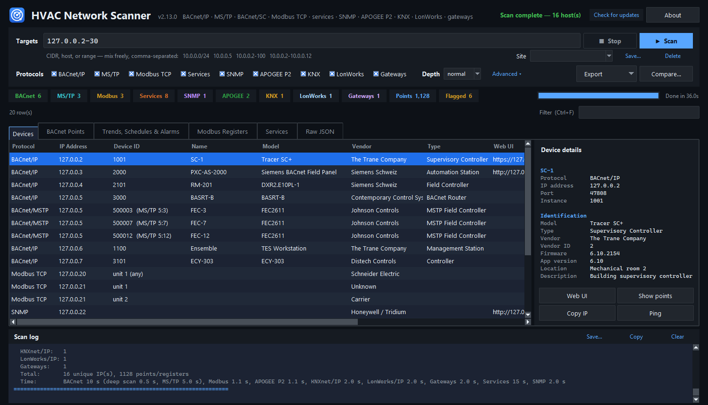

# HVAC Network Scanner

A multi-protocol discovery and audit tool for HVAC and building automation networks. Zero third-party dependencies — everything runs on the Python 3.10+ standard library.

**Website: [jamesccupps.github.io/HVAC-Network-Scanner](https://jamesccupps.github.io/HVAC-Network-Scanner/)**

Looking for a Siemens APOGEE P2 scanner or P2 Wireshark Decoder? See this project [P2Scanner](https://github.com/jamesccupps/P2_Wireshark_Dissector_And_P2_Scanner)

[](https://github.com/jamesccupps/HVAC-Network-Scanner/actions/workflows/ci.yml)
[](LICENSE)
[](https://www.python.org/downloads/)



## What it does

Scans a network and tells you what building-automation gear lives on it. For each device found it tries to identify the exact model, pull readable points or registers, and surface the factory-default credentials that ship with that product so you can confirm they've been changed. The report also checks the firmware each controller reports against published CISA ICS advisories (Trane Tracer SC+, Siemens APOGEE PXC, Desigo PXC and DXR2, Desigo CC), and says which to update and which to check by hand.

Works against:

- **BACnet/IP** — raw UDP `Who-Is` / `I-Am`, `ReadProperty`, and `ReadPropertyMultiple`. No BAC0 dependency, works on newer python versions. Reaches other subnets and VLANs by unicast discovery or through a BBMD. Reads BBMDs' broadcast and foreign-device tables, and each controller's trend logs, schedules and calendars as metadata.
- **BACnet MSTP** — device enumeration behind BACnet routers via `Who-Is-Router-To-Network` and targeted `Who-Is` to remote DNETs, including routers on other subnets with no BBMD.
- **BACnet/SC** — detects BACnet Secure Connect hubs (including ones devices name on nonstandard ports), and reports any that let a connection in without a client certificate.
- **KNXnet/IP** — finds KNX IP interfaces and routers on UDP 3671 and flags the ones offering tunnelling or routing without KNX Secure.
- **LonWorks/IP (IP-852)** — finds IP-852 routers and nodes on UDP 1628 (i.LON and SmartServer, LOYTEC L-IP, and controllers with an IP-852 channel of their own) and reads what each says about itself: node type, the name it was given, Neuron IDs, configuration server, and whether IP-852 authentication is on.
- **Serial gateways** — finds Moxa NPort, MGate and OnCell devices with Moxa's identify request on UDP 4800 (never its credential functions). These are often where P1, N2, MS/TP and Modbus RTU buses reach the network.
- **Modbus TCP** — port sweep, device identification (FC 43 / MEI 14), holding/input register reads, and coil reads.
- **HVAC services** — Niagara Fox (station name, Niagara version, OS, host ID, brand; AX stations flagged as end of life) and the Niagara platform ports, OPC UA (the server's own name and product, and whether it allows unsecured endpoints or anonymous sessions, on 4840 and KEPServerEX's 49320), Siemens S7, EtherNet/IP CIP, MQTT, WebCTRL, Metasys, plus HTTP/HTTPS banner grabs.
- **SNMP v1/v2c** — raw UDP `sysDescr` probe, no pysnmp dependency.
- **Siemens APOGEE P2** — detects firmware 2.x APOGEE field panels and P2
  supervisors on TCP/5033 without registering on them (see below).

Model identification combines signals from multiple protocols:

- Trane Tracer SC / SC+ / UC600 / UC400, Symbio, Tracer Ensemble, TR200 drives
- Siemens PXC Modular / Compact field panels, Desigo PXC4 / PXC5 / PXC7, DXR2 room controllers, Desigo CC, Insight
- Johnson Controls FEC / Metasys NAE
- Honeywell / Tridium Niagara
- Schneider EcoStruxure / SmartX
- Contemporary Controls BASRT-B routers
- Carrier i-Vu, Automated Logic WebCTRL, Alerton, Distech, Delta, KMC, Reliable, Carel, Belimo, Daikin, Mitsubishi (MelcoBEMS MINI), LG, Yaskawa HV600 drives, Moxa, and more

## Tested against (verified hardware)

The scanner has been verified against real hardware in live
installations. These devices have known-good classification profiles:

- **Trane Tracer SC+** — supervisory controller (5,000+ objects)
- **Trane Symbio 400-500** — field controller (MSTP)
- **Trane Tracer Ensemble (TES Workstation)** — supervisor
  (handles RPM rejection via fallback to single ReadProperty)
- **Siemens PXC Compact** (EPXC V3.5.x firmware) — field panel
- **Siemens PXC Modular** (PXME V3.5.x firmware) — field panel
  (verified with 1,960-object program)
- **Siemens DXR2.E10PL-1, .E12P-1, .E18-1** — room controllers
- **Siemens Desigo CC / Insight** — supervisors

Across these, the scanner has been tested with ~13,000 points read
and ~30,000 paired BACnet exchanges at zero wire-level errors.

**For hardware not on this list**, the scanner uses a size-based
heuristic that sets an appropriate object enumeration cap from the
device's own reported object count. This is expected to work
correctly for any BACnet-compliant device. If you scan a device that
isn't on this list, please consider [contributing a profile](CONTRIBUTING.md)
so future users can benefit from verified classification.

**Known out-of-scope:**

- Devices on serial buses: Siemens P1/FLN, Johnson Controls N2, LonTalk on
  twisted pair, MS/TP without a router, DALI, M-Bus. They are not on IP, so
  no network scanner sees them directly. The scanner finds the gateways
  that carry them: BACnet routers (and the MS/TP devices behind them),
  IP-852 routers, Moxa serial gateways, KNX IP interfaces.
- Reading points from panels running proprietary firmware without
  BACnet/IP. Siemens APOGEE PXC panels on firmware revision 2.x speak P2
  rather than BACnet/IP: the scanner **detects** them (and P2 supervisors)
  and tells you so, but does not read their points — that needs a P2
  session with the site's BLN name, which registers the client on the
  panel. For that, use the
  [P2 scanner](https://github.com/jamesccupps/P2_Wireshark_Dissector_And_P2_Scanner),
  a commercial gateway such as PurpleSwift BACnetP2, or upgrade the panels
  to firmware 3.x, which speaks BACnet/IP.

  How detection works: each host with TCP/5033 open gets one well-formed P2
  identify frame carrying a BLN name no site uses. A field panel resets the
  connection at its access gate, a supervisor listener closes it, both
  before any processing and without writing to the node table. One
  attempt, one fixed name — not a handshake and not BLN-name guessing.
- Proprietary BMS protocols that are not BACnet or Modbus TCP
  (JCI N2, LonTalk, Honeywell C-Bus, various others).

## Install

```bash
git clone https://github.com/jamesccupps/HVAC-Network-Scanner.git
cd HVAC-Network-Scanner
pip install -e .
```

Or run straight from the source tree without installing:

```bash
python -m hvac_scanner           # launches the GUI
python -m hvac_scanner.cli --help
```

Requires Python 3.10 or newer. No extra packages.

### Try it without a building

`tools/sim_site.py` stands up a small simulated site on loopback addresses —
a Trane SC+, Siemens PXC and DXR2 controllers, an MS/TP router with three
JCI field controllers behind it, a workstation that rejects
ReadPropertyMultiple, Modbus meters and a gateway, an APOGEE P2 panel and
supervisor, a Niagara JACE with SNMP
and Fox, and web UIs. Real sockets on the real ports, so the whole scanner
runs against it:

```bash
python tools/sim_site.py            # leave running
python -m hvac_scanner              # scan 127.0.0.2-30 in the GUI
```

The screenshot above was taken against it. Windows and Linux only (macOS
needs loopback aliases); ports below 1024 need root on Linux.

### Standalone executable

For a Windows machine without Python — an engineering workstation you would
rather not install anything on — grab `HVACNetworkScanner.exe` from the
[latest release](https://github.com/jamesccupps/HVAC-Network-Scanner/releases).
One ~13 MB file, no installer, no runtime.

To build it yourself:

```bash
pip install --require-hashes -r packaging/requirements-build.txt
pyinstaller packaging/hvac_scanner.spec --noconfirm
# -> dist/HVACNetworkScanner.exe
```

PyInstaller is a build dependency only; the package itself stays
dependency-free at runtime. `packaging/requirements-build.txt` pins it and
everything it needs by version and hash, the same file CI builds from. The executable ships the GUI — the CLI remains
available from a normal Python install.

**The executable is not code-signed.** On first run Windows SmartScreen will
show *"Windows protected your PC"* and you will need **More info → Run
anyway**. That warning means the binary has no purchased signing certificate,
not that anything is wrong with it — but a network scanner is exactly the sort
of program where you should not simply take that on trust.

Verify it before you run it. Each release publishes the SHA-256 of the
executable in its notes and as `HVACNetworkScanner.exe.sha256`; compare it
against the file you got:

```powershell
Get-FileHash .\HVACNetworkScanner.exe -Algorithm SHA256
```

The binary is built by GitHub Actions from the tagged commit, not on a
developer machine — the workflow is in
[.github/workflows/ci.yml](.github/workflows/ci.yml) and its build log is
public, so you can see exactly what went into it, including the hash. From
2.9.1 the build also signs an attestation that ties the file to that
workflow run and commit; with the [GitHub CLI](https://cli.github.com/):

```powershell
gh attestation verify .\HVACNetworkScanner.exe --repo jamesccupps/HVAC-Network-Scanner
```

If you would rather not trust a binary at all, build it yourself with the two
commands above; it is the same spec file and the same pinned tooling CI uses.

**Updates.** The executable checks for a new release once a day. From 2.13
it downloads it by itself, checks it against the release's `latest.json` (a
manifest signed with the project's Ed25519 key; the public half is built into
the app) and installs it when you close the scanner; **Restart to update to …**
in the header installs it at once. If anything fails, the previous exe is put
back. Turn **Install updates automatically** off in Advanced to be asked
instead (**Update to …**), or the daily check off altogether. A copy run from
Python is told about new versions instead. Copies older than 2.10 need one
manual download.

**Advisory list.** The firmware findings come from CISA's ICS advisories. A
daily GitHub workflow rebuilds the list from CISA's machine-readable data and
publishes it signed; the app picks it up with its daily check (or
`--update-advisories`), so new advisories reach the report without a new
release. The report says how current its list is.

## Using the GUI

```bash
python -m hvac_scanner
```

Type the network(s) to scan, tick the protocols, press **Scan** (or
Ctrl+Enter). Results appear as each device finishes, not at the end:

- **Devices** — one row per device across protocols: address, the device's
  own name, model, vendor, type, web UI and the factory-default credentials
  for that product. Select a row for everything the scan learned about it in
  the details panel; double-click it (or **Show points**) to list its points.
  Right-click for web UI, copy, ping.
- **BACnet Points** — every object read, with present value, engineering
  units and status. Points in alarm or fault are red, overridden or out of
  service amber, and multi-state values read as their state text
  ("Occupied"). Double-click a point for its full name and description.
- **Trends, Schedules & Alarms** — what each trend log records, how often,
  and whether it is still recording (disabled or full-and-stopped logs stand
  out); each schedule's weekly programme and the objects it controls; and
  each notification class's alarm recipients, priorities and
  acknowledgement (a class routed to no one stands out).
- **Modbus Registers**, **Services** (open ports, banners, page titles, TLS
  certificates) and **Raw JSON**.

The filter box (Ctrl+F) narrows every tab at once — type `vav` or a device
name or an IP. Column headers sort; IP addresses sort numerically. Ctrl+C
copies the selected rows as tab-separated text that pastes straight into a
spreadsheet. A device name that starts like a formula (`=`, `+`, `-`, `@`)
is pasted, and exported to CSV, as text: device names are chosen by whoever
controls the device, and BACnet names can be changed by anyone on the
network.

**Depth** sets how much of each device is read. *devices* reads only each
device's identity (name, model, vendor, firmware, description, location):
the fastest inventory, with no points; tick *Services* as well for devices
and their open ports. *quick* samples about 5% of each device's points,
*normal* (the default) reads up to each model's known size, and *full*
reads everything.

The scan log gives every section the clock time and the time since the
start, says how long each device took and how many of its requests went
unanswered, and ends with where the time went pass by pass.

**Export** writes a **survey report** (HTML — findings, inventory and open
services in one file you can hand to the building owner), the device list
(CSV), a **point list** (CSV, one row per point and register — the thing you
take away from a site survey), the full results (JSON, also Ctrl+S) or a
classification report. **Compare** diffs this
scan against an earlier JSON export.

**Advanced** holds the timeout (the longest wait; a device that has
answered quickly gets a shorter one, never under a second), the per-device rate limit (use 20-50 ms on
sites with small field controllers), parallel deep scans, a per-device time
limit (180 s; a device that reaches it keeps what was read and is marked
partial), unicast discovery,
BBMD registration, broadcast override, Who-Is chunking, an object cap,
SNMP communities, and the MS/TP address probe for trunks behind routers on
other subnets. Everything you set is remembered for next time; while the
panel is folded away the button says how many settings differ from the
defaults, and the scan log lists them when a scan starts. A number that is
not a number stops the scan with the reason rather than falling back to a
default. A scan of more than 1,024 addresses in all asks first.

**Site** saves the targets and every option under a name — for the
buildings you audit again and again — and brings them back from the list.
The CLI runs the same profiles with `--profile NAME`.

### Target syntax

The target field and CLI accept any mix of:

```
10.0.0.0/24                       # CIDR
10.0.0.5                          # single host
10.0.0.2-100                      # last-octet range
10.0.0.2-10.0.0.12                # full-IP range
10.0.0.0/30, 10.0.1.5, 10.0.2.1-20  # mixed list
```

The broadcast address for BACnet Who-Is is computed automatically from
whatever you type — narrow CIDRs (e.g. `/26`), ranges, and single hosts
all auto-broadcast to the enclosing `/24`. The scan log shows the chosen
broadcast target so it's never magic. Power users can override via the
`--broadcast` CLI flag or `ScanOptions.bacnet_broadcast`.

## Using the CLI

New in v2. Runs headless — no display, no Tk. Intended for Task Scheduler, cron, and CI pipelines.

```bash
# Basic scan of a /24
python -m hvac_scanner.cli 192.168.1.0/24

# Multiple networks, export to JSON and CSV
python -m hvac_scanner.cli 10.0.0.0/24 10.0.1.0/24 \
    --json scan.json --csv scan.csv

# BACnet only, with conservative rate limiting for small JACEs / UC400s
python -m hvac_scanner.cli 192.168.5.0/24 --bacnet-only --rate-limit 50

# Large-campus friendly: chunk Who-Is by 1000-instance ranges instead of
# one global broadcast. Avoids I-Am storms on big sites.
python -m hvac_scanner.cli 10.0.0.0/24 --whois-chunk 1000 --rate-limit 50

# Scan a narrow range of hosts — broadcast is auto-computed:
python -m hvac_scanner.cli 10.0.0.2-100

# Target specific devices only (no scan sweep at all):
python -m hvac_scanner.cli 10.0.0.19,10.0.0.21,10.0.0.192

# The BAS is on its own VLAN and broadcasts do not reach it: ask each
# address directly (this happens automatically for non-local subnets)
python -m hvac_scanner.cli 10.50.20.0/24 --unicast always

# ...and find the MS/TP devices behind its routers too, no BBMD needed
# (a few minutes per MS/TP network: two addresses at a time)
python -m hvac_scanner.cli 10.50.20.0/24 --unicast always --mstp-probe

# A site saved in the GUI, with its own targets and options
python -m hvac_scanner.cli --profile "Building A" --html survey.html

# Several SNMP communities, tried in turn
python -m hvac_scanner.cli 10.0.0.0/24 --snmp-community public --snmp-community bas

# Survey report and point list for the building owner
python -m hvac_scanner.cli 10.0.0.0/24 --html survey.html --points-csv points.csv

# ...or build the report later from a saved scan
python -m hvac_scanner.report scan.json -o survey.html

# Power-user: override the auto-computed broadcast
python -m hvac_scanner.cli 10.0.0.0/24 --broadcast 255.255.255.255

# Quiet mode for scheduled runs
python -m hvac_scanner.cli 192.168.5.0/24 --json /var/log/bas-scan.json --quiet

# Generate a classification report — handy when you've scanned gear
# that fell back to the heuristic and you want to submit a profile:
python -m hvac_scanner.cli 10.0.0.0/24 --export-classification report.txt
```

See [docs/CLI_USAGE.md](docs/CLI_USAGE.md) for the full flag reference and a Windows Task Scheduler XML example.

Exit codes:

- `0` — scan completed
- `1` — bad arguments (including a value out of range, more addresses than
  `--max-hosts`, or a `--baseline` file that is missing or damaged)
- `2` — interrupted (Ctrl+C), so the results are partial
- `3` — internal error
- `4` — scan completed and differed from the baseline (`--fail-on-change`)

## What's new

### v2.13.0 (2026-11-08)

- **The advisory list keeps itself current**: a daily job rebuilds it from
  CISA's data and publishes it signed, and the scanner downloads it with its
  daily check, so new advisories reach the report without a new release. The
  list now holds every CISA advisory for the products it covers (53 entries),
  and Desigo CC is checked per release.
- **Updates install themselves**: a new release downloads in the background
  and installs when you close the scanner, or at once with **Restart to update
  to …**. Turn **Install updates automatically** off in Advanced to be asked.

### v2.12.0 (2026-11-06)

- **Firmware covered by published advisories**: the report compares the
  firmware each controller reports with CISA ICS advisories (Trane Tracer SC+,
  Siemens APOGEE PXC, Desigo PXC and DXR2, Desigo CC) and lists the devices
  to update, with the version to update to, and those to check by hand.
  Versions are compared only; nothing is sent to test for the flaws.

### v2.11.0 (2026-11-06)

More of what a building network holds, and faster on unreliable controllers.
Full list in [CHANGELOG.md](CHANGELOG.md).

- **LonWorks/IP (IP-852)**: routers and nodes on UDP 1628 report their node
  type, name, Neuron IDs, configuration server and whether authentication
  is on.
- **Serial gateways**: Moxa NPort, MGate and OnCell devices, often where P1,
  N2, MS/TP and Modbus RTU buses reach the network, found with Moxa's
  identify request only.
- **OPC UA identity**: the server's own name and product, and whether it
  allows unsecured endpoints or anonymous sessions (4840 and KEPServerEX's
  49320). Niagara platform ports are probed too.
- **Adaptive timeout**: a controller that drops requests now costs about a
  second per drop, not the full timeout. On one site a quick scan went from
  3 min 39 s to 2 min 32 s and four lossy controllers from minutes to under
  half a minute each.
- **Accurate vendor names**: Alerton is Honeywell's; Vertiv and Copeland are
  no longer listed as Emerson.

### v2.10.0 (2026-11-06)

Tested on a real site over four rounds. Full list in
[CHANGELOG.md](CHANGELOG.md).

- **Updates from inside the app**: the executable checks once a day and
  installs a new release with one click, after checking it against a signed
  manifest; if anything fails the previous exe is put back. Copies older
  than 2.10 update by hand once.
- **Devices only** depth for a fast inventory, and a **per-device time
  limit** (180 s by default) so one bad controller cannot hold a scan up.
- **A log that says where the time went**: the clock on every section, how
  long each device took and how many requests it left unanswered, and a
  time summary at the end. The report lists controllers that drop requests.
- **Finds the whole site**: every silent address on another subnet is
  probed (and asked twice), whatever answered through a BBMD; lost packets
  no longer drop a controller to slow single reads; devices answering from
  outside the targets are named by subnet; the export records the BACnet
  port and the address the scan ran from.
- **Devices named for what they are** (DXR2 models, PXC Modular/Compact,
  Desigo PXC4/5/7, Insight, Tracer Ensemble, drives, gateways); the same
  fault on many identical controllers is one report row; the dark theme's
  scrollbars are visible.

### v2.9.1 (2026-11-06)

Fixes from an external review: robustness against broken or hostile
devices, gentler traffic, and exports that say what they are. Full list in
[CHANGELOG.md](CHANGELOG.md).

- **A broken or hostile device can no longer end a scan**: oversized
  integers, object counts in the billions, I-Am floods, Modbus servers that
  never finish a reply, and service banners that trickle in for hours are
  all bounded.
- **Gentler**: the scanner never shares UDP 47808 with BACnet software
  already running on the PC, sizes ReadPropertyMultiple to what each device
  can send back, opens at most two connections to a host at a time, and
  stops probing a Modbus unit a gateway says is absent.
- **Exports say what was scanned**: passes that were off, failed or stopped
  are recorded, and the report shows "Not scanned" instead of "None".
  Spreadsheet formulas in device names are neutralised; the classification
  report no longer holds addresses or names; a site's own SNMP community is
  not exported.
- Chunked Who-Is covers the whole instance range; the diff tells apart
  devices that share an instance number (and reports them); the release
  executable comes with a build attestation.

### v2.9.0 (2026-11-04)

- **Alarm routing**: every notification class's recipients, when they
  receive alarms and at what priority, with findings for classes routed to
  no one and recipients that did not answer the scan.
- **Router tables**: the networks a router knows through other routers,
  also used to reach MS/TP networks behind a chain of routers.
- A codec fix for six- and seven-octet context values (B/IP MAC addresses
  inside constructed values).

### v2.8.0 (2026-10-29)

The rest of the BACnet roadmap, and saved sites. Full list in
[CHANGELOG.md](CHANGELOG.md).

- **MS/TP behind routers on other subnets, without a BBMD**: networks are
  found from the routers' Network Port objects and asked with a routed
  Who-Is; `--mstp-probe` asks each MS/TP address to find the devices that
  only ever broadcast.
- **BBMD tables**: which subnets each BBMD links, and who is registered as a
  foreign device to hear the site's broadcasts.
- **Trend logs and schedules** as metadata — what is trended, how often,
  whether it is still recording; weekly programmes and what they control —
  in a new tab and in the survey report.
- **BACnet/SC detection**, with a high-severity finding for a hub that
  accepts connections without a client certificate.
- **Saved site profiles** in the GUI, runnable from the CLI with
  `--profile`.
- **KNXnet/IP detection**, a fuller **Niagara Fox** identity (and AX end
  of life flagged), Modbus **Report Server ID**, and BACnet/SC hubs found
  through the devices that name them — from checking the scanner against
  nmap, zgrab2, Redpoint, bacnet-stack and BACpypes3.

### v2.7.0 (2026-10-29)

A review-and-polish release. Highlights; the full list is in
[CHANGELOG.md](CHANGELOG.md).

**Correctness**

- **Engineering units were wrong for most point types.** A humidity sensor
  showed "W", a CO2 sensor "kPa-alt", an energy meter "kPa"; duct static,
  psi, gpm and kW had no label at all. The table is now the full
  BACnetEngineeringUnits enumeration. Object types 32-62 (Integer Value,
  Large Analog Value, Network Port, ...) were missing or off by one.
- **Devices relayed by a BBMD were put at the BBMD's address**, so the deep
  scan asked the wrong host. They are now attributed to their own address.
- **Modbus no longer reports phantom devices.** A gateway's "no device at
  this unit" exception counted as a device, and a meter that answers every
  unit ID was listed nine times.
- MS/TP devices found by the global Who-Is are labelled and counted as MS/TP.
  Binary points read active/inactive. Older HTTPS gear (TLS 1.0/1.1) now
  yields its banner and certificate.

**Speed** — about twice as fast end to end on the bundled simulated site (28 s
to 15 s). Sweeps of real subnets, where every empty address costs a
timeout, gain more:

- BACnet devices are deep-scanned in parallel (4 at a time by default),
  without any one controller or MS/TP trunk seeing more than one request.
- The Modbus and service sweeps use an asyncio connect sweep, port-major so
  each host sees one connection attempt at a time; SNMP sends to every host
  from one socket and waits once.

**New**

- **Unicast discovery** finds controllers on other subnets and VLANs, where
  a Who-Is broadcast never arrives.
- **A rebuilt GUI**: live summary and progress, a filter across every tab, a
  device details panel, point-list export, remembered settings, keyboard
  shortcuts, and an icon.
- **Point status**: points in alarm, fault, overridden or out of service
  are flagged, and multi-state values read as their state text.
- **An HTML survey report**: findings ranked by severity (default
  credentials on a reachable login, cleartext logins, SNMP defaults,
  certificates, flagged points), the inventory and open services, in one
  file for the building owner.
- A point-list CSV export, multiple SNMP communities, `--version`, and a
  hint when nothing answers (usually Windows Firewall, or a VLAN boundary).
- `tools/sim_site.py`, a simulated site to try the scanner on, which the
  end-to-end tests also run against.

- **Siemens APOGEE P2 detection**: firmware 2.x panels and P2 supervisors
  are found on TCP/5033 and identified, without a handshake and without
  registering on them, so an APOGEE building no longer looks empty.

Up next is in [ROADMAP.md](ROADMAP.md).

## Troubleshooting

**Nothing answers on BACnet.** On Windows, check Windows Defender Firewall
allows the scanner (python.exe or HVACNetworkScanner.exe) inbound UDP 47808:
replies to a broadcast come from addresses the scanner never sent to, and the
firewall drops them unless the program is allowed. Accept the prompt the first
time it runs, or add it under *Allow an app through firewall*.

**The controllers are on another subnet or VLAN.** A broadcast does not cross
a router. Unicast discovery handles this automatically for targets that are
not on a local /24; set it to `always` (Advanced, or `--unicast always`) to
force it, or register with a BBMD to reach MS/TP devices behind remote
routers too. UDP 47808 has to be routed between the two networks either way.

**Siemens APOGEE panels don't show up on BACnet.** Firmware 2.x panels speak
P2, not BACnet/IP. Keep *APOGEE P2* ticked and they are detected on TCP/5033
and listed as such; reading their points needs a P2 tool (see *Known
out-of-scope* above).

**Small controllers misbehave during a scan.** Set a rate limit of 20-50 ms
and lower Parallel devices to 1.

**A few controllers take minutes each.** They are dropping requests, and
each lost one costs a wait (about a second once the scanner has seen the
device answer, the full timeout before that). The log says how many went unanswered,
the report lists them under *Controllers that drop requests*, and the
per-device time limit (Advanced) caps what any one of them can cost. The
cause is usually near the controller: a cable, a duplex mismatch, errors on
its switch port, or a controller too busy to keep up.

## Safety and legal

This tool is intended for scanning networks you own or are authorized to audit. Running BACnet or Modbus sweeps against unfamiliar networks is at best rude and at worst unlawful in many jurisdictions. Building automation systems can also behave unpredictably when they see unexpected traffic — small field controllers have been known to lock up under probe load, and some equipment will fail-safe into unsafe mechanical states. Don't point it at anything you haven't been explicitly asked to assess.

The default-credentials database reflects the factory defaults published in each vendor's own documentation. It's here so the legitimate owner or operator of a system can quickly confirm whether defaults were ever changed, not as a remote-access toolkit. Those defaults are shown, never tried.

**What the scanner sends.** It reads; it does not write or reconfigure:

- **BACnet**: Who-Is (broadcast, ranged, routed or unicast),
  Who-Is-Router-To-Network, Read-BDT and Read-FDT, ReadProperty and
  ReadPropertyMultiple. No writes, no ReinitializeDevice, no
  DeviceCommunicationControl, no subscriptions; it never answers requests.
- **Modbus TCP**: function codes 43/14, 17, 3, 4 and 1 to a few unit IDs;
  never unit 0, never a write.
- **KNXnet/IP**: one description request; no connection, so no tunnel slot.
- **APOGEE P2**: one identify frame with a deliberately wrong BLN name.
- **Other services**: connect-and-close, an HTTP `GET /`, and banner reads;
  nothing logs in.

Two exceptions, both worth knowing about:

- **SNMP asks with a community string** (`public` unless you set others),
  which is a password of sorts: an agent may log a wrong one or send an
  authentication-failure trap. Turn SNMP off if that matters on the site.
- **BBMD registration (`--bbmd`, off by default) is a write**: it adds the
  scanner to the BBMD's foreign-device table so its broadcasts reach other
  subnets. The entry lasts at most 300 seconds (plus BACnet's 30-second
  grace) after the scan stops renewing it.

## Project layout

```
hvac_scanner/
├── constants.py       # Vendor DB, BACnet units, object types, HVAC ports
├── codec.py           # Pure-function BACnet packet encode/decode
├── bacnet.py          # UDP transport: shared socket, concurrent requests, RPM, unicast discovery
├── modbus.py          # Modbus TCP: per-host sessions, unit-ID probing, register reads
├── services.py        # TCP service probes, banners, TLS certificates
├── snmp.py            # Raw UDP SNMP sysDescr fan-out
├── netsweep.py        # asyncio TCP connect sweep shared by Modbus, P2 and services
├── p2.py              # Siemens APOGEE P2 detection (registration-free probe)
├── knx.py             # KNXnet/IP gateway detection
├── lonworks.py        # LonWorks/IP (IP-852) router and node detection
├── moxa.py            # Moxa serial gateway identify (UDP 4800)
├── opcua.py           # OPC UA server identity (GetEndpoints)
├── fingerprint.py     # Cross-protocol model identification
├── device_profiles.py # Per-vendor enumeration caps + scan-depth presets
├── netrange.py        # Target syntax: CIDR, ranges, host lists
├── engine.py          # ScanEngine orchestrator + result/export
├── certs.py           # Minimal X.509 parsing for HTTPS probes
├── diff.py            # Baseline comparison (what changed since last scan)
├── report.py          # HTML survey report (findings, inventory, services)
├── advisories.py      # Published ICS advisories matched to reported firmware
├── advisories.json    # The advisory list (rebuilt daily from CISA's data)
├── cli.py             # Headless command-line interface
├── gui.py             # Tk GUI (thin wrapper over ScanEngine)
├── settings.py        # Remembered GUI settings
├── text.py            # Device text made safe for logs and spreadsheets
├── updater.py         # In-app updates: signed manifest check, download, swap
├── ed25519.py         # Ed25519 signature check for the update manifest
├── update_key.py      # The public keys releases and the advisory list are signed with
├── icon.py            # The app icon, drawn in code
├── __main__.py        # `python -m hvac_scanner` → GUI
└── __init__.py        # Public API

tools/
├── sim_site.py        # Simulated BAS site on loopback (tests, demos, screenshots)
├── gui_demo.py        # Drive the GUI through a simulated scan and screenshot it
└── advisory_watch.py  # Rebuild the advisory list from CISA's CSAF feed (daily workflow)

data/advisories.signed.json  # The signed advisory list installed copies download

packaging/             # PyInstaller spec, hash-pinned build tooling, icon, entry point,
                       # signing.py (signs the release's latest.json),
                       # test_update.ps1 (a real update to the new build)

site/                  # The project page (GitHub Pages, .github/workflows/pages.yml)

tests/                 # 882 tests
├── test_e2e_site.py   # The whole engine against the simulated site
├── test_v27.py        # v2.7 fixes: units, BBMD origin, concurrency, Modbus, GUI
├── test_codec.py      # BACnet packet encode/decode + parser regressions
├── test_bacnet_client.py, test_rpm_batching.py, test_point_batching.py,
├── test_bbmd.py, test_mstp_routing.py, test_target_filtering.py, ...
├── test_modbus.py, test_snmp.py, test_certs.py, test_services_probes.py
├── test_engine.py, test_streaming.py, test_diff.py, test_fingerprint.py, ...
├── test_gui_options.py              # GUI controls reach ScanOptions (skips headless)
├── test_v291.py                     # 2.9.1: the external review's findings, one by one
├── test_v210.py                     # 2.10: updater, signing, report grouping, coverage
├── test_v211.py                     # 2.11: LonWorks/IP, Moxa, OPC UA, naming, adaptive timeout
├── test_v213.py                     # 2.13: advisory list download and CISA watcher, install on close
├── test_no_site_data.py             # Guard: no site-identifying data in the tree
└── conftest.py
```

## Development

```bash
git clone https://github.com/jamesccupps/HVAC-Network-Scanner.git
cd HVAC-Network-Scanner
pip install -e ".[dev]"
pytest
```

Pull requests welcome. See [CONTRIBUTING.md](CONTRIBUTING.md) and
[ROADMAP.md](ROADMAP.md).

## Contact

Open an [issue](https://github.com/jamesccupps/HVAC-Network-Scanner/issues) for bugs and feature requests. For security reports or general questions, email <jamesccupps@proton.me>.

## License

MIT — see [LICENSE](LICENSE).

## Author

James Cupps — <https://github.com/jamesccupps>
